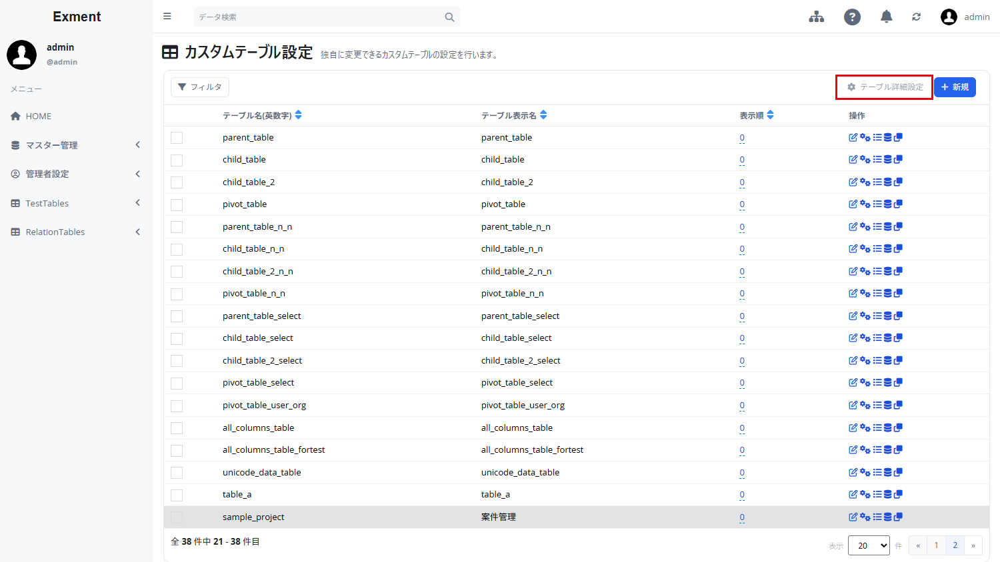
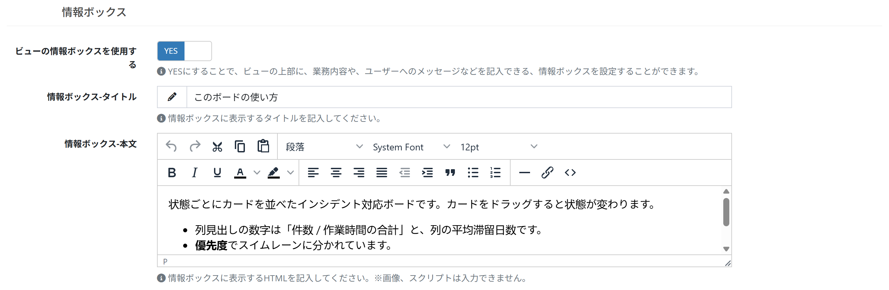
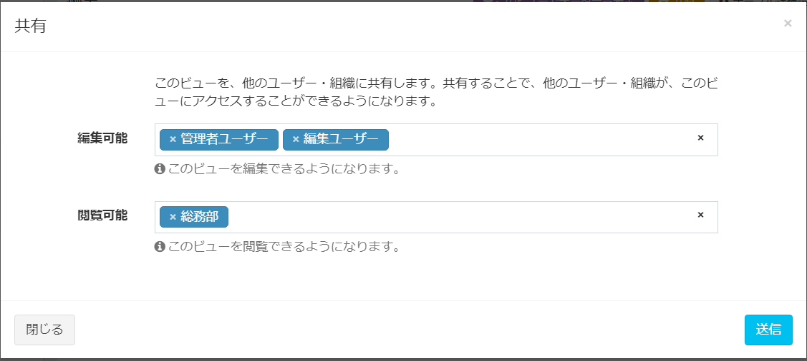

# 自定义视图
视图决定[数据列表页面](/zh/data_grid)的“显示方式”。每个视图分别决定显示哪些列、筛选出哪些数据、按什么顺序排列。  
本页说明视图的种类，以及视图的创建方法和设置项目。

设置的流程如下。

1. 打开视图列表（“打开页面”）  
2. 点击［新建］，选择要创建的视图种类（“新建视图”）  
3. 输入设置项目，点击［提交］保存

## 视图的种类
目前有以下种类。

| 种类 | 用途 |
|---|---|
| 视图（列表视图） | 以列表查看数据 |
| 汇总视图 | 按分组查看合计、件数等 |
| 日历视图 | 以日历的形式查看 |
| 看板视图 | 按状态分列，以卡片的形式查看 |
| 甘特图视图 | 用横条查看从开始日期到截止日期的期间 |
| 全部数据视图 | 系统自动创建的视图，形式与列表视图相同 |
| 条件视图 | 只用于筛选，例如通知的条件 |

### 视图（列表视图）

这是普通的视图，即数据列表。  
以列表显示已登记的数据。

### 汇总视图

把已登记的数据分组，显示合计、件数、最大值等汇总值。  
在仪表板中，可以显示为图表。

### 日历视图

以日历的形式显示已登记的数据。

### 看板视图

把已登记的数据按状态分列，以卡片的形式显示。  
把卡片拖到其他列，就可以更改该项目的值。  
详情请参阅[看板视图](/zh/view_kanban)。

### 甘特图视图
把已登记的数据用从开始日期到截止日期（结束日期）的横条显示，并按时间顺序排列。  
详情请参阅[甘特图视图](/zh/view_gantt)。

### 全部数据视图
基本上与列表视图相同，但有以下不同。  
- 由系统自动创建。  
- 只创建1个。用户不能新建，也不能删除。  
- 在[搜索](/zh/search)页面显示列表时使用。  
- 从汇总视图显示其明细数据时使用。

### 条件视图
只用于筛选的视图。用于[通知](/zh/notify)的通知条件，以及自定义列的列设置为“选项（从其他表中选择）”时的筛选。  
- 没有显示列的设置。  
- 不会出现在数据列表页面。  
- 只有管理员可以设置。普通用户不能设置。

## 打开页面
- 在自定义表列表中，勾选1个要设置的表，点击右上角的“表详细设置”。  
  
- 或者，从菜单中选择要设置的表，然后同样点击右上角的“表详细设置”。  
※需要事先把该表显示在菜单中。  
  
- 在表详细设置页面，点击视图设置的图标。  

- 这样就会显示该自定义表的视图列表。  

## 新建视图
- 在“自定义视图设置”页面，点击页面右上角的［新建］按钮。

在对话框中，点击要创建的种类的按钮。  
  
- 显示新建视图页面。输入必要的内容。

## 视图的设置项目
#### 视图显示名称
输入视图的名称。  

#### 视图权限
用“系统视图”或“用户视图”决定谁可以使用此视图。

- 系统视图  
只有系统管理员可以设置。  
对表有访问权限的所有用户都可以使用。

- 用户视图  
不是系统管理员也可以设置。  
只有创建它的用户可以使用。

※系统视图之后不能改为用户视图。  
**系统管理员创建的用户视图**，之后可以改为系统视图。  
※设置[禁用用户视图](/zh/config)后，普通用户将不能创建视图。

#### 每页显示条数
选择在数据列表中，每页显示多少条数据。

#### 默认
创建了多个视图时，用户打开数据列表后最先显示的，是设为“YES”的视图。  
※设为“NO”的视图，也可以从视图列表中选择后显示。  
※一个自定义表中，只有1个视图可以把“默认”设为“YES”。  
如果把2个以上的视图设为“YES”，除了最后设为“YES”的视图以外，其他都会变为“NO”。

#### 使用视图信息框
设为［YES］后，可以在视图上方显示信息框。  
可以输入标题和正文，显示业务内容或给用户的留言。

#### 选择显示列
设置视图中显示的列。  
这里设置的列，会显示在数据列表页面等处。

##### 目标列
视图中显示的列。  
  
##### 别名显示名称  
视图中会用这里输入的名称显示。  

##### 单元格外观预设  
选择在此视图中，该列以什么外观显示。  
※优先于自定义列设置的内容。详情请参阅[显示预设](/zh/cell_style_preset)。  

##### ［↓］按钮  
把视图中显示的项目向右移动。  

##### ［↑］按钮  
把视图中显示的项目向左移动。  

##### ［删除］按钮  
删除视图的显示列。

##### ［新建］按钮  
新增视图的显示列。

#### 视图筛选条件
筛选视图中显示的数据的条件。  
想要筛选时添加条件，例如“只显示期间内的数据”“只显示特定状态的数据”。  
※除了这项设置以外，系统还会进行筛选，只显示登录用户有权限的数据。没有权限的数据，无论这项设置如何，都不会显示。

>条件项目的列类型是“选项（从其他表中选择）”时，条件值中显示的文字，可以在[标题显示列设置](/zh/table)中更改。

##### 目标列　　
用作筛选条件的列。  
  
##### 条件
选择条件的内容。  
详情请确认[关于筛选条件](/zh/view?id=关于筛选条件)。  

##### 筛选条件值　　
输入与条件比较的值。  
  
##### ［删除］按钮　　
删除视图的显示条件。
  
##### ［新建］按钮　　
新增视图的显示条件。

#####   条件组合
选择“匹配所有条件”时，显示符合所有条件的数据。  
选择“匹配任一条件”时，显示至少符合其中1个条件的数据。

#####   条件反转
勾选“Reverse condition”（反转条件）后，显示不符合条件的数据。  
※汇总视图中不能使用条件反转。

#### 关于筛选条件
条件的选项，会随“目标列”中所选列的类型（“日期”“用户”等）而变化。  
这里只写需要说明的筛选条件。

##### 目标列的类型为“日期”时
- X天前的日期及以后  
- X天后的日期及以后  
- X天前的日期及以前  
- X天后的日期及以前  
数据的日期在该范围内时，显示在视图中。  

例：当前日期是1/15，筛选条件值登记为“8”时  

##### 目标列的类型为“用户”时
- 与登录用户一致  
数据的值与登录的用户相同时，显示在视图中。  

- 与登录用户不一致    
数据的值与登录的用户不同时，显示在视图中。  

#### 数据排序
设置视图中显示的数据的排序（显示顺序）。

 
##### 目标列  
用于排序的列。  

##### 排序  
指定按“升序（从小到大）”还是“降序（从大到小）”排序。  

##### ［↓］按钮  
降低优先级后按排序显示。  

##### ［↑］按钮  
提高优先级后按排序显示。  

##### ［删除］按钮  
删除视图的数据排序。  

##### ［新建］按钮　　
新增数据排序。

#### 视图筛选项目设置

指定在视图上方的“筛选”中，作为选项显示的列。
  

##### 目标列  
显示在“筛选”中的列。  

##### ［↓］按钮  
把“筛选”的项目向下移动。  

##### ［↑］按钮  
把“筛选”的项目向上移动。  

##### ［删除］按钮  
删除视图的“筛选”项目。  

##### ［新建］按钮　　
新增视图的“筛选”显示列。  

## 新建汇总视图
- 在“自定义视图设置”页面，点击页面右上角［新建］中的“新建汇总视图”。

- 显示新建汇总视图页面。输入必要的内容。

## 汇总视图的设置项目

#### 视图显示名称、视图权限、默认
与上面的[视图的设置项目](/zh/view?id=视图的设置项目)相同。

#### 选择分组列
按这里所选列的值，把数据分组后汇总。  
设置多个列时，按多个项目的组合分别汇总。

##### 目标列  
分组时作为依据的列。  

- 例1：目标列设置2列时，如图所示，按2列的组合分组后汇总。  
※“销售金额”不是分组列，而是设置为汇总列的列。

  

- 例2：只把“销售月”列设为分组列时，例1中连同“员工姓名”列一起分开的数据，会合并为1列的分组后汇总。  

  

##### 别名显示名称　　
视图中会用这里输入的名称显示。  

##### 列类型　　
只有目标列的自定义列类型为“日期”或“日期和时间”时，才可以从以下选项中选择。  
“按年”“按年月”“按年月日”“按月”“按日”“按星期”  
把目标列按这里所选的日期单位分组。  
※例1～3的图片，是把销售月的列类型设为“按年月”时的显示。

##### 排序方式　　
设置在汇总视图中显示数据的顺序。  
决定列的优先顺序，也就是先比较哪一列的值的大小来排列数据。  
顺序要把选择分组列和选择汇总列两者合在一起编号。  

- 例3：上面的例2，是在排序方式中把“销售月”列设为1、“销售金额”设为2时的显示。在排序方式中把“销售月”设为2、“销售金额”设为1时，如下图所示，会优先按“销售金额”列的值排序。  

  

##### 排序依据  
设置目标列按值从小到大还是从大到小排列。  
选择“升序（从小到大）”或“降序（从大到小）”。  

- 例4：上面的例3，是在排序依据中把“销售金额”设为降序时的显示。设为升序时，如下图所示。  

  

##### ［箭头］按钮
设置汇总视图中列的排列顺序。  
选择分组列中越靠上的项目，在汇总视图中越靠左显示。  

##### ［删除］按钮  
删除视图的分组列。

##### ［新建］按钮  
新增视图的分组列。

#### 选择汇总列
汇总这里所选列的值。  

##### 目标列  
要汇总值的列。  

##### 汇总类型  
“合计”“件数”“最小值”“最大值”  
从这4种汇总类型中选择。所选汇总的结果，显示在视图的目标列中。

##### 别名显示名称  
视图中会用这里输入的名称显示。  

##### ［删除］按钮  
删除视图的汇总列。
  
##### ［新建］按钮  
新增视图的汇总列。

#### 显示条件
筛选视图中显示的数据的条件。  
想要筛选时添加条件，例如“只显示期间内的数据”“只显示特定状态的数据”。  
※除了这项设置以外，系统还会进行筛选，只显示登录用户有权限的数据。没有权限的数据，无论这项设置如何，都不会显示。

>条件项目的列类型是“选项（从其他表中选择）”时，条件值中显示的文字，可以在[标题显示列设置](/zh/table)中更改。

##### 目标列  
用作筛选条件的列。  
  
##### 筛选条件  
选择条件的内容。  
详情请确认[关于筛选条件](/zh/view?id=关于筛选条件)。  
  
##### 筛选条件值  
输入与条件比较的值。  
  
##### ［删除］按钮  
删除视图的显示条件。
  
##### ［新建］按钮  
新增视图的显示条件。

## 新建日历视图

- 在“自定义视图设置”页面，点击页面右上角［新建］中的“新建日历视图”。

- 显示新建日历视图页面。输入必要的内容。

## 日历视图的设置项目

#### 视图显示名称、视图权限、默认
与上面的[视图的设置项目](/zh/view?id=视图的设置项目)相同。

#### 选择显示列
设置视图中显示的列。  
在日历视图中，设置开始日期和结束日期后，可以把日期列的数据作为期间显示。  
※如果只想显示在某1天，请只指定开始日期。

##### 开始日期  
请设置作为期间开始日期的列。  
※不设置结束日期时，只在开始日期所设列的那一天显示。

##### 结束日期  
请设置作为期间结束日期的列。

##### 显示颜色  
设置视图中显示的数据的背景色。

##### 文字颜色  
设置视图中显示的数据的文字颜色。

##### ［删除］按钮  
删除视图的显示列。

##### ［新建］按钮  
新增视图的显示列。

#### 显示条件
筛选视图中显示的数据的条件。  
想要筛选时添加条件，例如“只显示期间内的数据”“只显示特定状态的数据”。  
※除了这项设置以外，系统还会进行筛选，只显示登录用户有权限的数据。没有权限的数据，无论这项设置如何，都不会显示。

>条件项目的列类型是“选项（从其他表中选择）”时，条件值中显示的文字，可以在[标题显示列设置](/zh/table)中更改。

##### 目标列  
用作筛选条件的列。  
  
##### 筛选条件  
选择条件的内容。  
详情请确认[关于筛选条件](/zh/view?id=关于筛选条件)。  
  
##### 筛选条件值  
输入与条件比较的值。  
  
##### ［删除］按钮  
删除视图的显示条件。
  
##### ［新建］按钮  
新增视图的显示条件。

#### 日历视图中的标题
如图片中的例子，在日历视图中，数据的日期处会显示标题。  

- 显示的标题，是在[标题显示列设置](/zh/table)中设置的内容。

- 另外，如果在选择显示列的开始日期中，设置了自定义列类型为“日期和时间”的列，数据的时间会显示在标题的开头。  

## 保存
输入设置后，请点击［提交］。

## 预览
在视图的新建、编辑页面，点击页面右上角的［预览］按钮，可以在另一个窗口中确认，按正在输入的设置，数据会怎样显示（数据列表、看板、甘特图）。  
可以在保存设置之前确认显示效果。

- 显示［预览］按钮的，是列表视图、全部数据视图、看板视图、甘特图视图。汇总视图、日历视图、条件视图等不显示。  
- 预览不会保存设置。更改设置后要刷新显示，请在原来的页面再次点击［预览］按钮。  
- 在“选择显示列”“视图筛选条件”“数据排序”中，没有选择目标列或条件的行，不会反映到预览中。这时，预览页面会显示“有 ○ 行没有选择目标列或条件，因此未在此预览中显示。”。

## 编辑
要编辑视图，请点击该行的［编辑］链接。  

## 删除
要删除视图，请点击该行的［删除］链接。  

## 复制自定义视图
点击［复制此视图］链接后，会创建一个设置相同、只有视图显示名称为空的视图。

## 显示数据列表
点击［在此视图中列出数据］按钮后，按该视图的设置显示数据列表。

## 共享自定义视图
把创建的自定义视图共享给其他用户、组织。  
※只有“用户视图”可以共享。（“系统视图”从一开始就对所有有权限的用户公开。）  
※可以选为共享对象的，是对表有访问权限的用户或组织。  

#### 共享方法
1. 点击自定义视图编辑页面上的“共享”按钮。  
※新建时不显示此按钮。  

2. 显示自定义视图的共享对话框。  

3. 添加要共享的用户或组织，点击“提交”。这样就完成共享了。  
  
