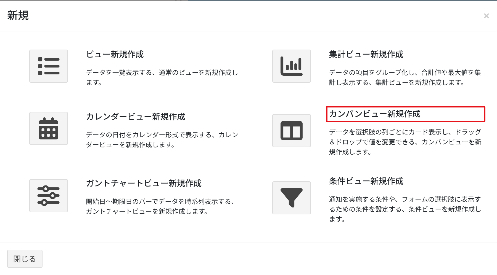
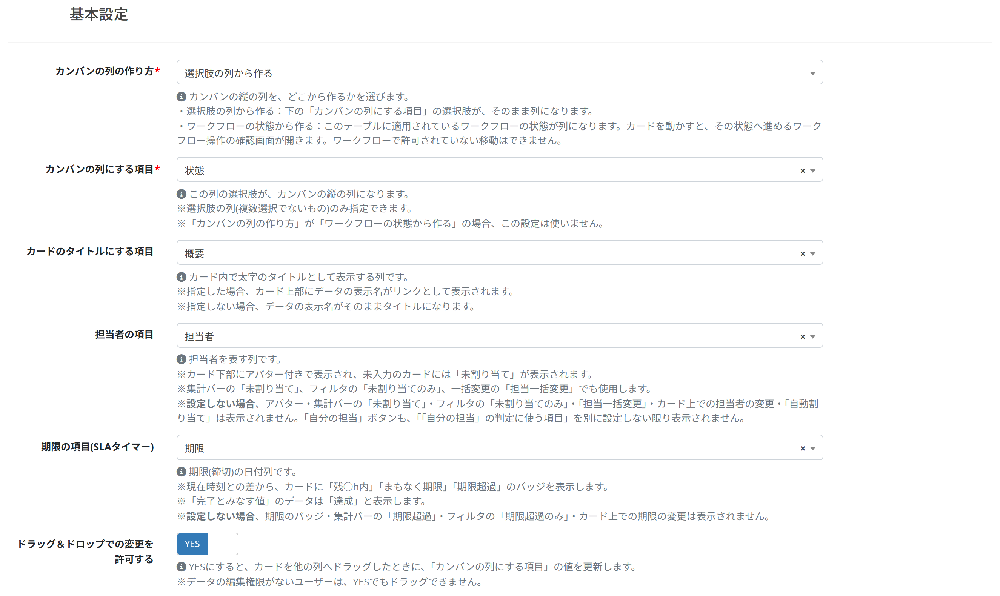
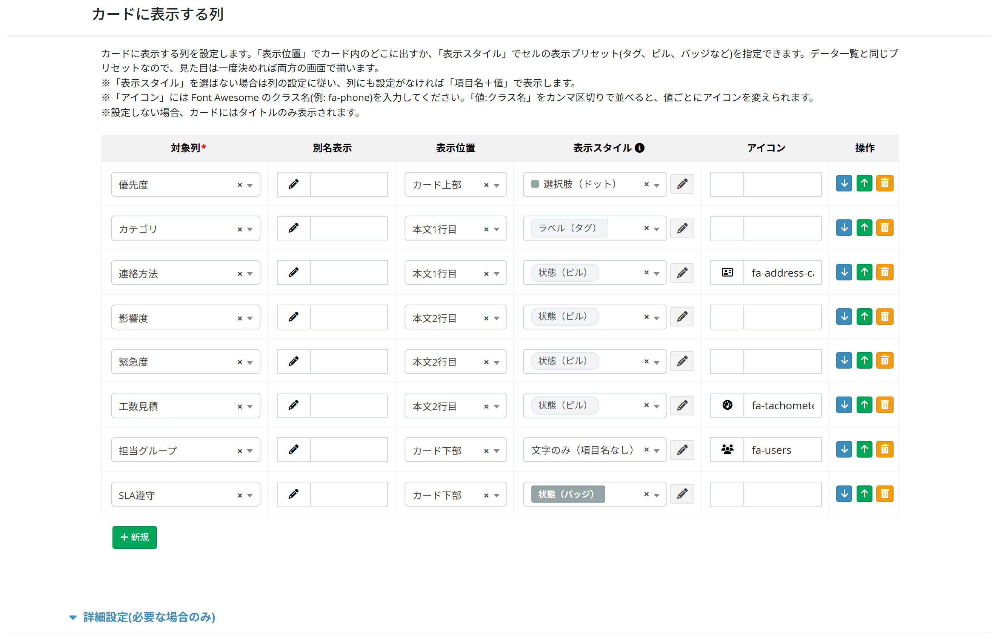
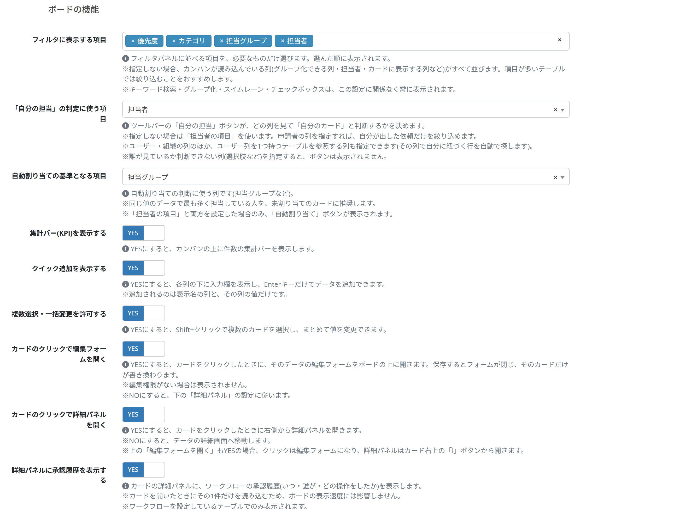
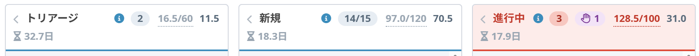
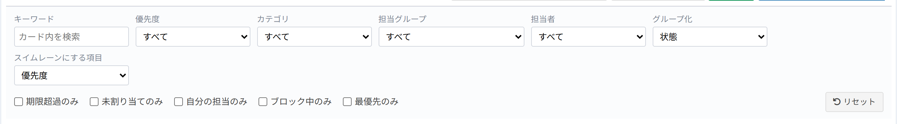
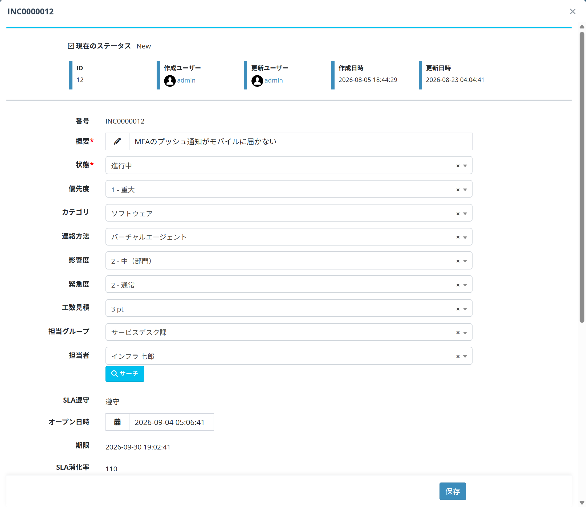
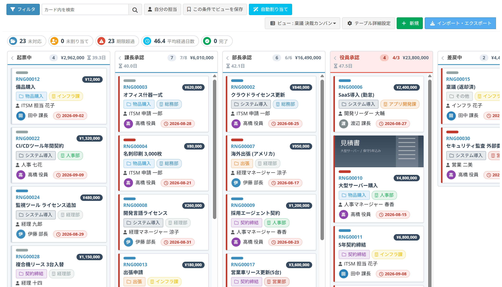

# 看板视图

把数据以卡片的形式排列在“按状态划分的列”中，并可以通过拖放更改状态的视图。

## 什么是看板视图

看板是一种管理方法：用1张卡片表示一项工作，并把卡片排列在“未处理”“处理中”“完成”这样的工序列中。  
哪项工作停在哪个工序，一眼就能看出；只要把卡片移到下一列，就可以推进状态。

Exment 的看板视图可以做到以下事情。

- 把选项列（状态、优先级等）或工作流的状态，直接作为纵向的列
- 拖动卡片，更新该项目的值
- 在卡片上显示负责人、截止日期、标签、进度条等
- 在列标题中显示每列的件数、合计金额、平均停留天数
- 点击卡片，在看板上打开编辑表单

## 新建视图

1. 打开自定义视图设置页面（请参阅[自定义视图](/zh/view)）。
2. 点击右上角的［新建］按钮。
3. 在显示的对话框中选择“新建看板视图”。

## 基本设置

#### 看板列的生成方式
选择看板的纵向列从哪里生成。

| 选项 | 内容 |
| --- | --- |
| 根据选项列的值生成 | 下面“作为看板列的项目”的选项，直接成为列。 |
| 根据工作流的状态生成 | 此表所应用的工作流的状态成为列。移动卡片时，会打开推进到该状态的工作流操作的确认页面。工作流不允许的移动无法进行。 |

※在没有设置工作流的表中，不显示此项目。

#### 作为看板列的项目
此列的选项，成为看板的纵向列。  
※只能指定选项列（非多选的列）。  
※“看板列的生成方式”为“根据工作流的状态生成”时，不使用此设置。

#### 作为卡片标题的列
在卡片内以粗体标题显示的列。  
※指定时，卡片顶部会以链接的形式显示数据的显示名称。  
※不指定时，数据的显示名称直接成为标题。

#### 负责人列
表示负责人的列。在卡片底部带头像显示，未输入的卡片显示“未分配”。  
汇总栏的“未分配”、筛选的“仅显示未分配”、批量更改的“批量分配”也会使用此列。

※不设置时，不显示头像、汇总栏的“未分配”、筛选的“仅显示未分配”、“批量分配”、卡片上的负责人更改、“自动分配”。

#### 截止日期列（SLA 计时）
截止日期的日期列。根据与当前时间的差，在卡片上显示“剩余 ○h”“即将到期”“已逾期”的徽章。  
※“视为已完成的值”的数据显示为“已达成”。  
※不设置时，不显示截止日期的徽章、汇总栏的“已逾期”、筛选的“仅显示已逾期”、卡片上的截止日期更改。

#### 允许通过拖放更改值
设为 YES 后，把卡片拖到其他列时，会更新“作为看板列的项目”的值。  
※没有数据编辑权限的用户，即使设为 YES 也不能拖动。

## 卡片上显示的列

设置排列在卡片中的项目。不设置时，卡片上只显示标题。

| 项目 | 内容 |
| --- | --- |
| 目标列 | 显示在卡片上的列 |
| 别名显示名称 | 要更改卡片上显示的名称时输入 |
| 显示位置 | 显示在卡片内的什么位置 |
| 显示样式 | 以什么外观显示 |
| 图标 | Font Awesome 的类名（例：fa-phone） |

### 显示位置

| 选项 | 显示的位置 |
| --- | --- |
| 卡片顶部 | 标题的上方 |
| 正文第 1 行 | 标题的下方，第1行 |
| 正文第 2 行 | 标题的下方，第2行 |
| 卡片底部 | 卡片的最下方 |

### 显示样式

从与数据列表相同的“单元格外观预设”中选择。外观只要决定一次，列表和看板中的显示就会相同。

| 设置 | 卡片的显示 |
| --- | --- |
| 选择预设 | 按该预设的外观（标签、胶囊、徽章、圆点、头像等）显示。**优先于列的设置** |
| 未选择 | 按列一侧的“显示预设”或列的显示设置显示 |
| 两者都未设置 | 以“项目名：值”的形式显示 |

每个值的颜色直接使用列一侧的设置。预设只决定形状，所以同一个预设可以用于任何列。

可以通过铅笔按钮新建、编辑预设。详情请参阅[单元格外观预设](/zh/cell_style_preset)。

> 工作流状态、创建时间等“不是列的项目”，选择预设后也可以用相同的外观显示。不过，每个值的颜色是列的设置，所以不适用于这些项目。

### 图标
输入 Font Awesome 的类名（例：fa-phone）。预设中包含图标时，也以这里的指定为优先。  
想让每个选项使用不同的图标时，用逗号分隔输入“值:类名”。  
例：`phone:fa-phone,mail:fa-envelope,chat:fa-comments`

## 详细设置（仅在需要时）

保持初始值，看板也可以运行。请只在需要时设置。

### 卡片显示设置

#### 封面图片列
在卡片顶部作为封面显示的图片列。  
※没有登记图片的数据，显示时没有封面。登记了多张时，使用第1张。

#### 封面图片显示方式
“填满（超出部分裁剪）”会铺满整个框，并裁掉超出的部分。  
“完整显示（留白）”会放入整张图片，并带有留白。

#### 彩色标签列
在卡片顶部作为彩色标签显示的选项列。也可以指定可多选的列。  
※在没有指定“在筛选面板中显示的列”期间，这里指定的列也会添加到筛选中。

#### 标签显示方式
“带文字的标签”是带文字的小标签，“仅色条”是只有颜色的细条。

#### 角标列
在卡片右上角作为小徽章显示的列（件数、点数、编号等）。值为空的数据不显示。

#### 显示为进度条的数值列 / 进度条的最大值
在卡片标题的下方显示进度条。  
0%～49%为蓝色，50%～99%为橙色，100%为绿色。  
“进度条的最大值”是进度条达到100%的值（未输入时为100）。

#### 计算经过天数的基准列 / 经过天数的颜色分级
作为计算经过天数基准的日期列（受理日等）。卡片左端的颜色会随经过天数变化。  
“经过天数的颜色分级”中，按从小到大的顺序，用逗号分隔输入3个颜色变化的天数。  
例：`1,2,3` → 1天为黄色，2天为橙色，3天以上为红色。  
例：`3,7,14` → 适合较长的工序。  
不更改时为 `1,2,3`。

#### 截止前多少小时发出提醒
把距离截止日期不足这个时间的卡片设为“即将到期”（黄色）。  
例：咨询时为 2（小时），交期以天为单位时为 48（＝2天）。未输入时为2小时。

### 看板列

#### 作为泳道的项目
按此列的值，把看板横向分隔显示。不指定时，不分隔显示。

#### 在列标题中显示合计的项目
在列标题的下方，显示此数值项目的合计。  
例：选择金额后，会显示“董事批准 ¥34,700,000”这样的内容，停在该列的金额一眼就能看出。  
※仅用于显示。不影响 WIP 上限。

#### 显示每列的平均停留天数
在列标题的下方，显示该列的卡片平均停留了多少天。可以看出在哪个工序停留（瓶颈）。  
※工作流时从“变为该状态的时间”算起，其他情况从“最后更新时间”算起。

#### 每列的 WIP 上限
为每列设置“可同时持有的件数上限”。超过上限的列，标题会变红。

| 项目 | 内容 |
| --- | --- |
| 目标列 | 要设置上限的列（从表的选项中选择） |
| 上限 | 该列可同时放置的件数（1～999。添加行时为5） |

#### WIP 上限的计数方式（数值列）
WIP 上限不按“件数”计算，而按此数值项目的合计计算。  
例：选择数量后，列标题中会显示“1550/1200”这样的合计值和上限。  
※只能指定整数、小数、货币的项目。

#### 移入已满的列

| 选项 | 动作 |
| --- | --- |
| 允许（仅标题变红） | 与以前相同。只是标题变红，可以移动。 |
| 先确认再允许 | 显示确认信息，点击 OK 后移动。 |
| 不允许 | 达到上限的列在拖动时变为灰色，不能移入。 |

※“视为加急的值”的卡片不受此限制。但会计入件数。

#### 列规则
在列标题中显示该列的规则。把鼠标放到标记上，就会显示内容。  
例：在“测试中”的列写上“测试规格书的所有项目都为 OK 后进入下一步”，所有人都能看到进入下一步的条件。

#### 视为已完成的值
从表的选项中，选择作为“完成”处理的看板列。  
所选列的数据会停止截止日期的计时，并计入汇总栏的“已完成”。  
※根据工作流生成时，设置为“完成”的状态会自动作为完成处理，不需要在这里指定。

#### 视为受阻的值
选择表示“停滞的工作”的值。带有所选值的卡片会加上红框和旗帜标记，汇总栏和筛选中会增加“受阻”。

#### 视为加急的值
选择表示“插入的最优先事项”的值。带有所选值的卡片会加上醒目的边框；如果按该值划分泳道，该泳道会固定在最上方。  
※把很多值设为加急就失去意义了。请限定为1个或2个。

#### 不在看板上显示的列
所选值的列不显示在看板上。  
例：选择“完成”“取消”后，已结束的工作会消失，看板上只剩进行中的工作。  
※不会加载隐藏列的数据。在数据量大的表中，仅此一项就能大幅加快显示。

### 看板功能

| 项目 | 内容 |
| --- | --- |
| “我的”按钮判断所用的列 | 决定工具栏的“我的卡片”按钮根据哪一列判断“自己的卡片”。不指定时使用“负责人列”。 |
| 自动分配所用的列 | 用于自动分配判断的列（负责小组等）。在值相同的数据中负责最多的人，会被推荐给未分配的卡片（请参阅下面的“自动分配”）。 |
| 在筛选面板中显示的列 | 排列在筛选面板中的项目。按选择的顺序显示。未指定时，显示看板加载的所有列。 |
| 显示汇总栏（KPI） | 在看板上方显示件数的汇总栏。 |
| 显示快速添加 | 在各列的下方显示输入框，只按 Enter 键就可以添加数据。 |
| 允许多选和批量更改 | 用 Shift＋点击选择多张卡片，一起更改值。 |
| 点击卡片时打开编辑表单 | 点击卡片时，在看板上打开该数据的编辑表单。 |
| 点击卡片时打开详细信息面板 | 点击卡片时，从右侧打开详细信息面板。 |
| 在详细信息面板中显示审批历史 | 在卡片的详细信息面板中显示工作流的审批历史。只能在设置了工作流的表中选择。 |

※在新建的视图中，汇总栏、快速添加、多选、编辑表单、详细信息面板、审批历史全部为 YES。

※“打开编辑表单”和“打开详细信息面板”都设为 YES 时，点击会打开编辑表单，详细信息面板从卡片右上角的“i”按钮打开。  
※两者都为 NO 时，点击后会跳转到数据的详细页面。

### 加载条数

#### 每列加载的卡片数
每1列最初加载的卡片件数（0～500。新视图中为0）。  
设为 0（未输入）时，整个看板最多加载到“最大显示条数”。  
输入 50 等数值时，每列各加载50件，列的下方会出现［加载更多］按钮。

※件数、合计、平均停留天数、汇总栏不是已加载卡片的汇总，而是汇总整个数据库得到的正确值。  
※因筛选或关键字等而只汇总已加载的卡片时，会显示“仅显示已加载的○张卡片（共○条）。…”。  
※**数据有数千件时，推荐使用这种方式。** 不受“最大显示条数”上限的限制。

#### 最大显示条数
看板上显示的数据的最大件数（1～2000）。件数多时显示会变慢。  
新视图中为300；设置了环境键 `EXMENT_KANBAN_MAX_SIZE_COUNT` 时为该值。

## 看板的使用方法

### 页面说明

#### 工具栏

| 按钮 | 内容 |
| --- | --- |
| 筛选 | 打开筛选面板 |
| 在卡片中搜索 | 用关键字筛选卡片 |
| 我的卡片 | 只显示自己负责的卡片 |
| 将此条件保存为视图 | 用当前的筛选条件创建新视图 |
| 自动分配 | 在页面上未分配的卡片中，给置信度高的卡片分配负责人（见下文） |

#### 自动分配

［自动分配］不只是推荐，还会**写入**负责人。

- 页面上未分配的卡片中，置信度在85%以上的，会当场分配负责人。
- 其他卡片保持未分配。卡片上会显示推荐的负责人和比例，详细信息面板中会显示“仅建议（请人工确认）”和［应用此负责人］按钮。
- 因筛选或“在卡片中搜索”而隐藏的卡片，以及位于视为完成的列中的卡片，不在对象之内。
- 结果会显示为“N 条已自动分配（置信度 85% 以上）／ M 条仅为建议”。

#### 汇总栏（KPI）

最多显示6个数值。每个数值只在做了相应设置时才显示。

| 数值 | 显示的条件 |
| --- | --- |
| 未处理 | 始终显示 |
| 未分配 | 设置了“负责人列” |
| 已逾期 | 设置了“截止日期列（SLA 计时）” |
| 平均经过天数 | 设置了“计算经过天数的基准列” |
| 受阻 | 设置了“视为受阻的值” |
| 已完成 | 设置了“视为已完成的值”（在工作流的看板中，是设为完成的状态） |

※按列加载时，“受阻”有时会像“≥8”这样显示为“至少这么多件”。  
※想要筛选时，请使用［筛选］中的“仅显示已逾期”“仅显示未分配”等勾选项。

#### 列标题

从左起依次是：折叠列的“‹”、列名、规则的标记、件数、受阻的件数、WIP、合计、平均停留天数。

- 件数是正在显示的卡片数。按列加载且还有剩余时，显示为“显示中/全部”（例：14/15）。
- WIP（“已加载/上限”）是与件数不同的显示，只在设置了 WIP 上限的列中显示。
- 受阻的件数只在有受阻卡片的列中显示。
- 合计和平均停留天数，在视图设置中设为 ON 时，只在有卡片的列中显示。

#### 卡片

根据设置，显示标签、编号、优先级、经过天数、标题、进度条、各项目、负责人、截止日期。

### 移动卡片

把卡片拖到其他列后，“作为看板列的项目”的值会被更新。  
更新后，页面下方会显示［撤销］，可以取消刚才的移动。

※没有编辑权限时不能拖动。  
※根据工作流生成的列，会打开工作流操作的确认页面。

### 筛选

点击［筛选］后，打开筛选面板。

- 可以按各项目的值筛选
- “分组”“作为泳道的项目”可以在此页面临时切换
- 可以使用筛选的勾选项。每个勾选项只在可以使用时显示
  - “仅显示已逾期”…设置了“截止日期列（SLA 计时）”
  - “仅显示未分配”…设置了“负责人列”
  - “仅显示分配给我的”…“我的”按钮判断所用的列是用户列，看板能够判别“自己”
  - “仅显示受阻”…设置了“视为受阻的值”
  - “仅显示加急”…设置了“视为加急的值”
- 用［重置］清除面板的内容

在筛选的状态下点击［将此条件保存为视图］，可以新建一个带该条件的视图。

### 编辑表单

把“点击卡片时打开编辑表单”设为 YES 时，点击卡片后会在看板上打开编辑表单。

- 保存后表单关闭，**只有那张卡片**会被改写。不会重新加载整个看板。
- 有输入错误时，表单保持打开，并在项目旁边显示信息。
- 可以用 Esc 键关闭。

### 详细信息面板

点击卡片右上角的“i”按钮（只启用详细信息面板时，点击卡片），会从右侧打开详细信息面板。

- 除了在“卡片上显示的列”中设置的项目以外，还可以确认作为看板列的项目、封面图片、标题、进度条、标签、角标
- 在［移动到］中选择，不用拖动就可以更改列
- 用［打开记录］跳转到普通的详细页面

在“根据工作流的状态生成”的看板中，会显示可执行的工作流操作的按钮，以及审批历史（“在详细信息面板中显示审批历史”为 YES 时）。此看板不显示［移动到］。  
在根据选项列生成的看板中，即使是设置了工作流的表，也不显示工作流操作和审批历史。

### 多选和批量更改

把“允许多选和批量更改”设为 YES 时，可以用 **Shift＋点击**（或 Ctrl＋点击）选择多张卡片。

- 用［批量更改…］一起更改所选卡片的列（状态等）
- 用［批量分配…］一起更改负责人
- 用［取消选择］取消选择

### 快速添加

把“显示快速添加”设为 YES 时，各列的最下方会显示输入框。  
只要输入标题并按 Enter 键，就可以新登记一条带有该列的值的数据。

※登记的只有显示名称的列，以及该列（状态等）的值。其他项目请之后再编辑。

## 根据工作流生成列

在“看板列的生成方式”中选择“根据工作流的状态生成”后，表所应用的工作流的状态会直接成为列。

- 移动卡片时，会打开推进到该状态的工作流操作的确认页面
- 工作流不允许的移动无法进行
- 设置为“完成”的状态会自动作为完成处理

在申请、审批的业务中，可以按列显示等待审批的件数和金额，所以能马上看出审批停在哪里。

## 处理大量数据时

对于数据超过数千件的表，推荐以下设置。

1. **把“每列加载的卡片数”设为 50 左右**  
   每列一点一点地加载，需要时再用［加载更多］追加。件数和合计显示的不是已加载卡片的值，而是整个数据库的正确值。
2. **用“不在看板上显示的列”排除完成类的列**  
   只要不加载已结束的工作，显示速度就会大幅改善。
3. **用视图的“视图筛选条件”缩小对象**  
   按期间、负责部门等，从一开始就缩小加载的范围。

## 相关项目

- [自定义视图](/zh/view)
- [数据列表的操作工具](/zh/data_grid_tools)
- [工作流设置](/zh/workflow_setting)
- [流程设计器](/zh/workflow_design)
