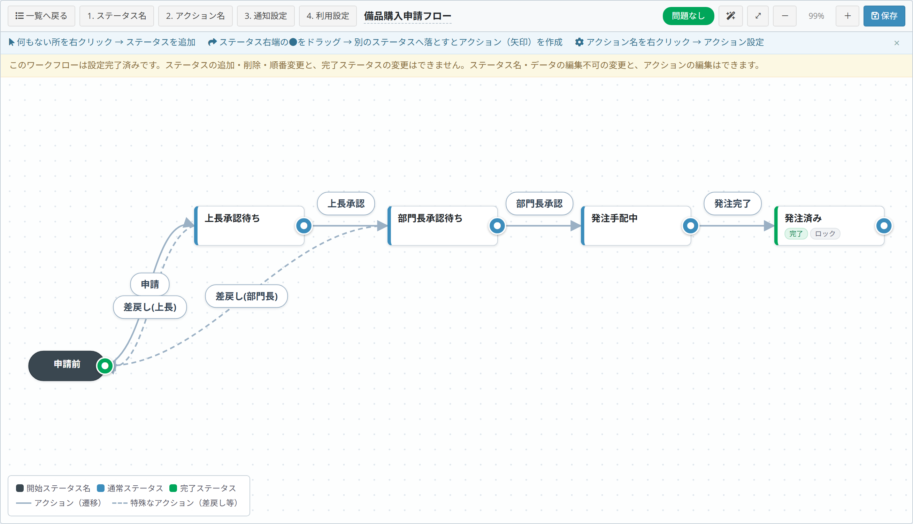
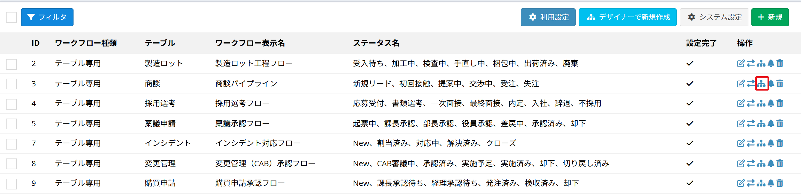
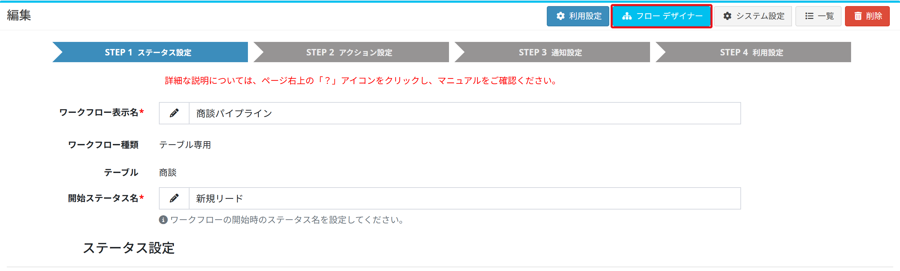
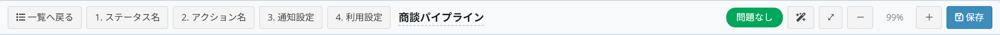
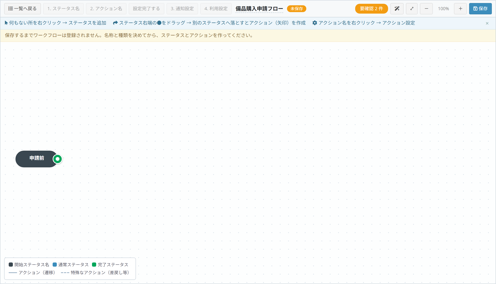
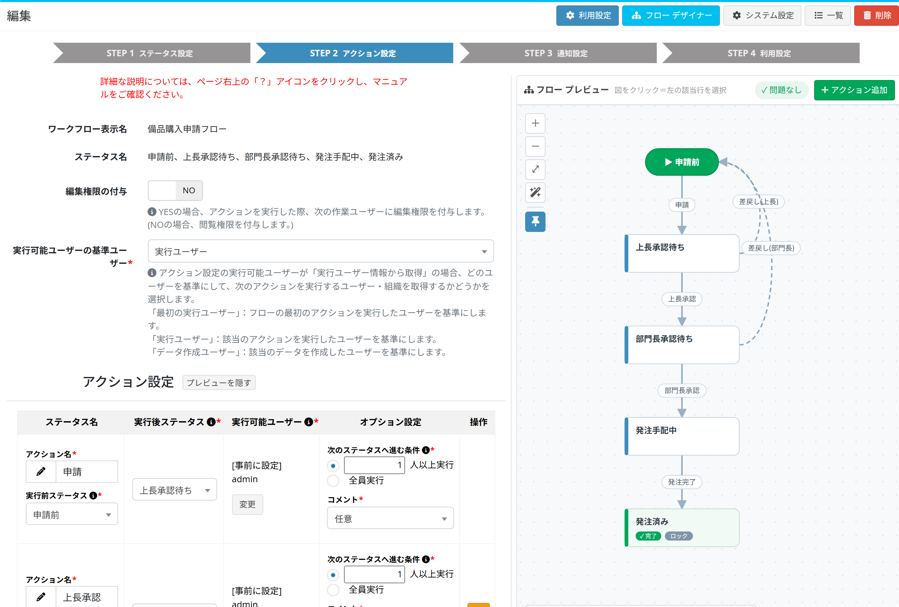

# 流程设计器

在这个画面上，可以直接在流程图上创建和编辑工作流的状态和操作。

## 什么是流程设计器

在[工作流设置](/zh/workflow_setting)中，状态在“步骤 1”的表格里设置，操作在“步骤 2”的表格里设置。  
只用表格设置时，下面这些地方会不容易看清。

- 从哪个状态可以进入哪个状态
- 有没有走不下去的状态
- 退回的路线有没有正确连接

流程设计器是 **一边看图** 一边创建和编辑这些内容的画面。

- 保存位置与步骤 1、步骤 2 相同。在设计器中创建的内容，会直接反映到步骤 1、2 的表格中
- 从哪个画面设置都可以。也可以先用图创建，再用表格调整细致的条件

## 打开画面

### 1. 用图编辑已有的工作流

在工作流设置的列表中，点击对象行的［流程设计器］图标。

在步骤 1、步骤 2 的画面，也可以用右上角的［流程设计器］按钮打开。

### 2. 从图开始创建新的工作流

在工作流设置的列表中，点击右上角的［使用设计器新建］按钮。

## 画面的看法

### 工具栏

| 项目 | 内容 |
| --- | --- |
| 返回列表 | 回到工作流设置的列表 |
| 1. 状态名称 / 2. 操作名称 | 转到表格形式的设置画面（步骤 1、步骤 2） |
| 完成设置 | 完成工作流的设置。位于“2. 操作名称”的右边，完成设置后不再显示。详情请参阅[工作流设置](/zh/workflow_setting) |
| 3. 通知设置 / 4. 使用设置 | 完成设置后可以使用 |
| （工作流名称） | 正在编辑的工作流的名称 |
| 没有问题 / ○ 项需确认 | 输入检查的结果。点击后显示内容 |
| 自动排列 | 自动重新排列节点的位置 |
| ⤢（适应窗口） | 让整个图都显示在画面内 |
| －／＋ | 更改显示倍率 |
| 保存 | 保存编辑的内容 |

### 操作提示

画面上方始终显示基本的操作方法。

### 图例

| 显示 | 含义 |
| --- | --- |
| 黑色节点 | 开始状态 |
| 蓝色节点 | 普通状态 |
| 绿色节点 | 完成状态 |
| 实线箭头 | 操作（进入下一个状态的操作） |
| 虚线箭头 | 特殊操作（退回等不计入处理用户的操作） |

节点上的“完成”“锁定”标记，分别表示完成状态和禁止编辑数据。

## 基本操作

### 添加状态

在图中 **右键点击空白处**，选择［添加状态］。

| 项目 | 内容 |
| --- | --- |
| 添加状态 | 在右键点击的位置创建新的状态 |
| 自动排列 | 自动重新排列节点的位置 |
| 适应窗口 | 让整个图都显示在画面内 |

### 创建操作（箭头）

**拖动状态右端的●**，在另一个状态上松开。  
这样就会创建连接 2 个状态的操作（箭头）。

在空白处松开时，可以选择“创建新状态并连接”。可以连续进行状态的创建和操作的创建。

### 更改操作的设置

**右键点击操作名称**，选择［操作设置］。

| 项目 | 内容 |
| --- | --- |
| 操作设置 | 设置操作名称、可执行用户和选项 |
| 删除操作 | 删除这个箭头（操作） |

### 更改状态的设置

**右键点击状态**，可以更改状态名称、指定完成状态、删除状态。

※有数据的状态不能删除。想要删除时会显示“正在使用，无法删除”。  
※开始状态不能删除。只能更改名称。

### 整理图的布局

- 节点可以用拖动自由移动
- 用［自动排列］，自动重新排成从左向右流动的形状
- 用［⤢（适应窗口）］，把倍率调整到整个图都显示在画面内

### 保存

点击右上角的［保存］按钮。  
在保存之前，更改的内容不会反映到数据库。有没有保存的更改时，工具栏上会显示“未保存”。

※没有保存就要离开页面时，会显示确认消息。  
※其他人先更新了同一个工作流时，会显示“此工作流已在其他页面中被更新”。请重新加载页面后再保存一次。

## 需确认（输入检查）

工具栏的右侧始终显示输入内容的检查结果。

- 没有问题时显示绿色的“没有问题”
- 有问题时显示橙色的“○ 项需确认”

点击后以列表显示内容，再点击就会移动到对应的位置。

主要的检查内容如下。

| 消息 | 含义 |
| --- | --- |
| 未输入工作流名称。当前状态下无法保存。 | 不输入名称就不能保存 |
| 工作流名称超过 30 个字符。当前状态下无法保存。 | 名称最多 30 个字符 |
| 请选择工作流类型。／请选择目标表。 | 选择工作流类型；类型是“表专用”时还要选择目标表 |
| 未输入开始状态名称。当前状态下无法保存。 | 请输入开始状态的名称 |
| 没有从“○○”开始的操作。 | 没有从开始状态进入下一步的箭头 |
| 没有状态。／没有操作。 | 请添加 1 个以上的状态和操作 |
| 请至少设置一个完成状态。 | 完成状态必须正好是 1 个 |
| 没有到达“○○”的操作。 | 有从任何地方都到不了的状态 |
| “○○”没有出发的操作，也不是完成状态。 | 有走不下去的状态 |
| 操作“○○”未设置执行前状态／执行后状态。 | 操作前后的状态都要选择 |
| 操作“○○”引用了已删除的状态。 | 箭头指向了不存在的状态 |
| 存在未输入操作名称的行。当前状态下无法保存。 | 所有的操作都需要名称 |
| 操作“○○”的操作名称超过 30 个字符。 | 操作名称最多 30 个字符 |
| 操作“○○”的执行前状态与执行后状态相同。当前状态下无法保存。 | 不能设置回到同一个状态的箭头 |
| 操作“○○”未设置可执行用户。当前状态下无法保存。 | 请设置谁可以执行 |
| 操作“○○”的“进入下一状态的条件”人数必须为 0～10 的数字。 | 请修改人数 |

关于操作的可执行用户，在下面的情况下也会显示消息：把“特殊操作”和“由上一操作的执行用户选择”组合在一起时；在第一个操作中指定了“由上一操作的执行用户选择”或“预先设置”以外的设置时；在同一个执行前状态中把“由上一操作的执行用户选择”和其他设置一起使用时。

“没有到达…的操作”“…没有出发的操作…”是警告，不会阻止保存。其他的消息会阻止保存。

## 使用设计器新建

从［使用设计器新建］打开时，首先显示“基本信息”对话框。

| 项目 | 内容 |
| --- | --- |
| 工作流显示名称 | 工作流的名称（最多 30 个字符） |
| 工作流类型 | “通用”或“表专用” |
| 表 | 工作流的目标表。只有类型是“表专用”时才输入 |
| 开始状态名称 | 第一个状态的名称（“起草中”“申请前”等） |

输入后点击［保存］，图的左侧会显示开始状态。

之后，用右键添加状态，拖动●把操作连接起来。

> **保存之前工作流不会被登录。**  
> 创建状态和操作并保存后，工具栏的［完成设置］就可以点击，然后可以进入步骤 3（通知设置）和步骤 4（使用设置）。

## 步骤 2 的“流程预览”

在步骤 2（操作设置）的画面上，右侧也会显示流程图。

- 编辑表格后，图会马上更新
- 点击图中的操作，会选中左侧表格中对应的行
- 用［＋添加操作］在表格中添加行
- ［○ 项需确认］是和设计器相同的输入检查

### 保存布局（图钉按钮）

切换是否记录移动节点后的布局。

- 在图钉按下的状态下保存画面，当前的布局会被记录，下次打开时也是同样的排列
- 没有按下时，布局不会保存，每次都以自动排列显示

### 隐藏预览

不需要图时，可以用［隐藏预览］把它隐藏。表格的输入栏可以用得更宽。

## 注意事项

#### 编辑已完成设置的工作流时
执行了［完成设置］的工作流，和步骤 1 一样，状态是固定的。

- 不能添加、删除状态或更改状态的顺序，也不能更改完成状态。右键菜单的［添加状态］［删除状态］会显示“已完成设置，无法更改”，不能选择。
- 状态名称、“禁止编辑数据”以及所有的操作仍然可以编辑。

除此之外，**申请中的数据或历史中使用的状态，即使在完成设置之前也不能删除。**

#### 完成状态
完成设置之前的工作流，完成状态**正好是 1 个**。

- 完成状态只能设置 1 个。有多个时，请只留下 1 个，取消其他的之后再保存。
- 1 个完成状态都没有时也不能保存。
- 在步骤 1 的画面保存时，也只有表格最后一行的 1 个状态成为完成状态。

已完成设置的工作流，有时会因为来自模板等原因而有多个完成状态。这时会原样保留，不能在流程设计器中更改。

#### 关于筛选条件（分支）
操作的筛选条件在步骤 2 的画面设置。  
在流程设计器中保存，已设置的条件也不会消失。在图中，分支显示为“条件 1”“条件 2”。

## 相关项目

- [工作流设置](/zh/workflow_setting)
- [工作流设置示例](/zh/workflow_example)
- [执行工作流](/zh/workflow_execution)
- [看板视图](/zh/view_kanban)
