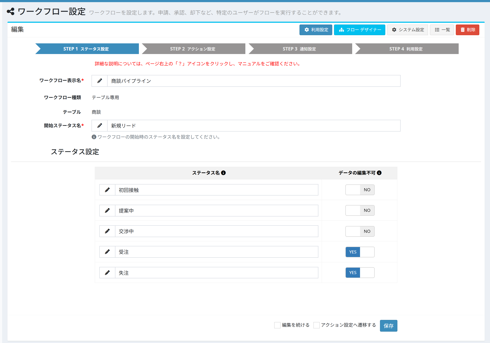
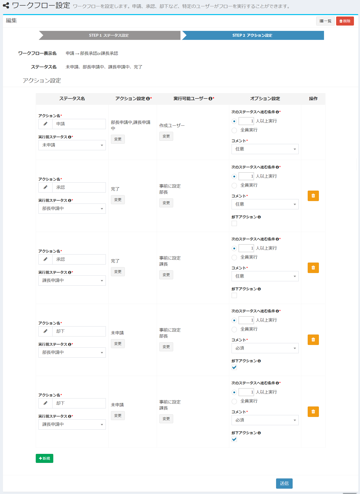
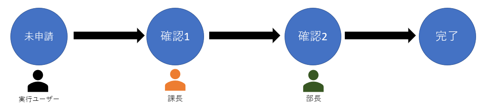

# 工作流设置示例
这里是工作流的设置示例。请选择与想要创建的流程接近的示例，照着输入。  
各项目的含义请参阅[工作流设置](/zh/workflow_setting)。

| 想要创建的流程 | 示例 |
|---|---|
| 只是申请后批准或驳回的简单流程 | [申请 → 批准/驳回](#example1) |
| 按申请数据的金额区分批准的人（操作） | [申请 → 部长批准or课长批准/驳回](#example2) |
| 分 2 个阶段确认。确认的人都从申请人的上级列决定 | [未申请 → 确认1 → 确认2 → 完成(从首个执行用户信息获取)](#example4) |
| 分 2 个阶段确认。第 2 个人是第 1 个确认的人的上级 | [未申请 → 确认1 → 确认2 → 完成(从执行用户信息获取)](#example5) |
| 锁定数据(不能编辑和删除) | [数据的锁定](#example3) |

<h2 id="example1"><a href="#/zh/workflow_example?id=example1" data-id="example1" class="anchor">申请 → 批准/驳回</a></h2>

这是申请数据后批准或驳回的简单流程的设置方法。  

  
- 用户向管理部申请
- 管理部批准申请，或者驳回
- 已批准的数据，之后不能再修改

### Step1.状态设置

  

- **工作流显示名称** : 任意的名称

- **工作流类型** : “通用”

- **开始状态名称** : “未实施”

- **状态 第1行**  
状态名称：“申请中”  
禁止编辑数据：“YES”  

- **状态 第2行**  
状态名称：“完成”  
禁止编辑数据：“YES”  

### Step2.操作设置

  

- **操作设置 第1行**  
操作名称：“申请”  
执行前状态：“未实施”  
操作设置 > 执行后状态：“申请中”  
可执行用户 : “创建用户”  
选项设置 > 进入下一状态的条件 : “1人以上执行”  
选项设置 > 评论 : “可选”  

- **操作设置 第2行**  
操作名称：“批准”  
执行前状态：“申请中”  
操作设置 > 执行后状态：“完成”  
可执行用户 : “管理组”※请事先创建组织“管理组”  
选项设置 > 进入下一状态的条件 : “2人以上执行”  
选项设置 > 评论 : “可选”  
选项设置 > 特殊操作 : 不勾选  

- **操作设置 第3行**  
操作名称：“驳回”  
执行前状态：“申请中”  
操作设置 > 执行后状态：“未实施”  
可执行用户 : “管理组”※请事先创建组织“管理组”  
选项设置 > 进入下一状态的条件 : “1人以上执行”  
选项设置 > 评论 : “必填”  
选项设置 > 特殊操作 : 勾选  

<h2 id="example2"><a href="#/zh/workflow_example?id=example2" data-id="example2" class="anchor">申请 → 部长批准or课长批准/驳回</a></h2>

这是按申请数据的金额区分操作和负责人时的设置方法。    

  
- 用户申请经费
- 申请数据的“金额”在 100,000 日元以上时自动分给部长，不到 100,000 日元时自动分给课长
- 部长或课长批准申请，或者驳回
- 已批准的数据，之后不能再修改

### Step1.状态设置

  

- **工作流显示名称** : 任意的名称

- **工作流类型** : “表专用”

- **表** : 选择执行工作流的表

- **开始状态名称** : “未申请”

- **状态 第1行**  
状态名称：“部长申请中”  
禁止编辑数据：“YES”  

- **状态 第2行**  
状态名称：“课长申请中”  
禁止编辑数据：“YES”  

- **状态 第3行**  
状态名称：“完成”  
禁止编辑数据：“YES”  

### Step2.操作设置

  

- **操作设置 第1行**  
操作名称：“申请”  
执行前状态：“未申请”  
操作设置 > 执行后状态：参照下面的图片  

  
>条件项目的列类型是“选项（从其他表中选择）”时，条件值中显示的文字可以在[标题显示列设置](/zh/table)中更改。

可执行用户 : “创建用户”  
选项设置 > 进入下一状态的条件 : “1人以上执行”  
选项设置 > 评论 : “可选”  

- **操作设置 第2行**  
操作名称：“批准”  
执行前状态：“部长申请中”  
操作设置 > 执行后状态：“完成”  
可执行用户 : “部长”※请事先创建组织“部长”  
选项设置 > 进入下一状态的条件 : “1人以上执行”  
选项设置 > 评论 : “可选”  
选项设置 > 特殊操作 : 不勾选  

- **操作设置 第3行**  
操作名称：“批准”  
执行前状态：“课长申请中”  
操作设置 > 执行后状态：“完成”  
可执行用户 : “课长”※请事先创建组织“课长”  
选项设置 > 进入下一状态的条件 : “1人以上执行”  
选项设置 > 评论 : “可选”  
选项设置 > 特殊操作 : 不勾选  

- **操作设置 第4行**  
操作名称：“驳回”  
执行前状态：“部长申请中”  
操作设置 > 执行后状态：“未申请”  
可执行用户 : “部长”※请事先创建组织“部长”  
选项设置 > 进入下一状态的条件 : “1人以上执行”  
选项设置 > 评论 : “必填”  
选项设置 > 特殊操作 : 勾选  

- **操作设置 第5行**  
操作名称：“驳回”  
执行前状态：“课长申请中”  
操作设置 > 执行后状态：“未申请”  
可执行用户 : “课长”※请事先创建组织“课长”  
选项设置 > 进入下一状态的条件 : “1人以上执行”  
选项设置 > 评论 : “必填”  
选项设置 > 特殊操作 : 勾选  

<h2 id="example4"><a href="#/zh/workflow_example?id=example4" data-id="example4" class="anchor">未申请 → 确认1 → 确认2 → 完成(从首个执行用户信息获取)</a></h2>

这是“未申请 → 确认1 → 确认2 → 完成”流程的设置方法。操作的可执行用户设为“从首个执行用户信息获取”。   

  
- 操作“确认1”，由申请人（流程的首个执行用户）的“上级1”列中设置的用户执行
- 操作“确认2”，由申请人（流程的首个执行用户）的“上级2”列中设置的用户执行

### Step0.用户列设置

首先，请在“用户”表的自定义列设置中添加下面的列。

  

- 列1：
    - 列名（英文和数字）：“boss1”
    - 列显示名称：“上级1”
    - 搜索索引：YES
    - 列类型：用户

- 列2：
    - 列名（英文和数字）：“boss2”
    - 列显示名称：“上级2”
    - 搜索索引：YES
    - 列类型：用户
  
然后，请编辑各用户的信息，登记“上级1”“上级2”列的内容。

  

※用户“执行用户”的数据像上面这样登记时，工作流会像下面这样执行。

  

### Step1.状态设置

- **工作流显示名称** : 任意的名称

- **工作流类型** : “通用”

- **开始状态名称** : “未申请”

- **状态 第1行**  
状态名称：“确认1”  
禁止编辑数据：“NO”  

- **状态 第2行**  
状态名称：“确认2”  
禁止编辑数据：“NO”  

- **状态 第3行**  
状态名称：“完成”  
禁止编辑数据：“YES”  

### Step2.操作设置

  

- **共通设置**  
可执行用户的基准用户 : “首个执行用户”  

- **操作设置 第1行**  
操作名称：“操作1”  
执行前状态：“未申请”  
执行后状态：确认1  
可执行用户 : “创建用户”  
选项设置 > 进入下一状态的条件 : “1人以上执行”  
选项设置 > 评论 : “可选”  

- **操作设置 第2行**  
操作名称：“操作2”  
执行前状态：“确认1”  
执行后状态：“确认2”  
可执行用户 : (从执行用户信息获取)上级1  
选项设置 > 进入下一状态的条件 : “1人以上执行”  
选项设置 > 评论 : “可选”  
选项设置 > 特殊操作 : 不勾选  

- **操作设置 第3行**  
操作名称：“操作3”  
执行前状态：“确认2”  
执行后状态：“完成”  
可执行用户 : (从执行用户信息获取)上级2  
选项设置 > 进入下一状态的条件 : “1人以上执行”  
选项设置 > 评论 : “可选”  
选项设置 > 特殊操作 : 不勾选  

#### 参考：点击“可执行用户”的更改按钮时的对话框

  

<h2 id="example5"><a href="#/zh/workflow_example?id=example5" data-id="example5" class="anchor">未申请 → 确认1 → 确认2 → 完成(从执行用户信息获取)</a></h2>

这是“未申请 → 确认1 → 确认2 → 完成”流程的设置方法。操作的可执行用户设为“从执行用户信息获取”。   

  
- 操作“确认1”，由申请人（流程的首个执行用户）的“上级”列中设置的用户执行
- 操作“确认2”，由执行了操作“确认1”的用户的“上级”列中设置的用户执行

### Step0.用户列设置

首先，请在“用户”表的自定义列设置中添加下面的列。

  

- 列：
    - 列名（英文和数字）：“boss”
    - 列显示名称：“上级”
    - 搜索索引：YES
    - 列类型：用户

  
然后，请编辑各用户的信息，登记“上级”列的内容。  
先把最初的用户“执行用户”的数据设成下面这样。

  

再把用户“系长”的数据设成下面这样。

  

※数据像上面这样登记时，工作流会像下面这样执行。

  

### Step1.状态设置

- **工作流显示名称** : 任意的名称

- **工作流类型** : “通用”

- **开始状态名称** : “未申请”

- **状态 第1行**  
状态名称：“确认1”  
禁止编辑数据：“NO”  

- **状态 第2行**  
状态名称：“确认2”  
禁止编辑数据：“NO”  

- **状态 第3行**  
状态名称：“完成”  
禁止编辑数据：“YES”  

### Step2.操作设置

  

- **共通设置**  
可执行用户的基准用户 : “执行用户”  

- **操作设置 第1行**  
操作名称：“操作1”  
执行前状态：“未申请”  
执行后状态：确认1  
可执行用户 : “创建用户”  
选项设置 > 进入下一状态的条件 : “1人以上执行”  
选项设置 > 评论 : “可选”  

- **操作设置 第2行**  
操作名称：“操作2”  
执行前状态：“确认1”  
执行后状态：“确认2”  
可执行用户 : (从执行用户信息获取)上级  
选项设置 > 进入下一状态的条件 : “1人以上执行”  
选项设置 > 评论 : “可选”  
选项设置 > 特殊操作 : 不勾选  

- **操作设置 第3行**  
操作名称：“操作3”  
执行前状态：“确认2”  
执行后状态：“完成”  
可执行用户 : (从执行用户信息获取)上级  
选项设置 > 进入下一状态的条件 : “1人以上执行”  
选项设置 > 评论 : “可选”  
选项设置 > 特殊操作 : 不勾选  

#### 参考：点击“可执行用户”的更改按钮时的对话框

  

<h2 id="example3"><a href="#/zh/workflow_example?id=example3" data-id="example3" class="anchor">数据的锁定</a></h2>

这是想锁定特定数据(不能编辑和删除)时的设置方法。  

  
- 创建人锁定数据／解除锁定
- 被锁定的数据，在解除之前不能修改

### Step1.状态设置

  

- **工作流显示名称** : 任意的名称

- **工作流类型** : “通用”

- **开始状态名称** : “未实施”

- **状态 第1行**  
状态名称：“锁定”  
禁止编辑数据：“YES”  

### Step2.操作设置

  

- **操作设置 第1行**  
操作名称：“执行锁定”  
执行前状态：“未实施”  
操作设置 > 执行后状态：“锁定”  
可执行用户 : “创建用户”  
选项设置 > 进入下一状态的条件 : “1人以上执行”  
选项设置 > 评论 : “可选”  

- **操作设置 第2行**  
操作名称：“解除锁定”  
执行前状态：“锁定”  
操作设置 > 执行后状态：“未实施”  
可执行用户 : “创建用户”  
选项设置 > 进入下一状态的条件 : “1人以上执行”  
选项设置 > 评论 : “可选”  
选项设置 > 特殊操作 : 勾选
