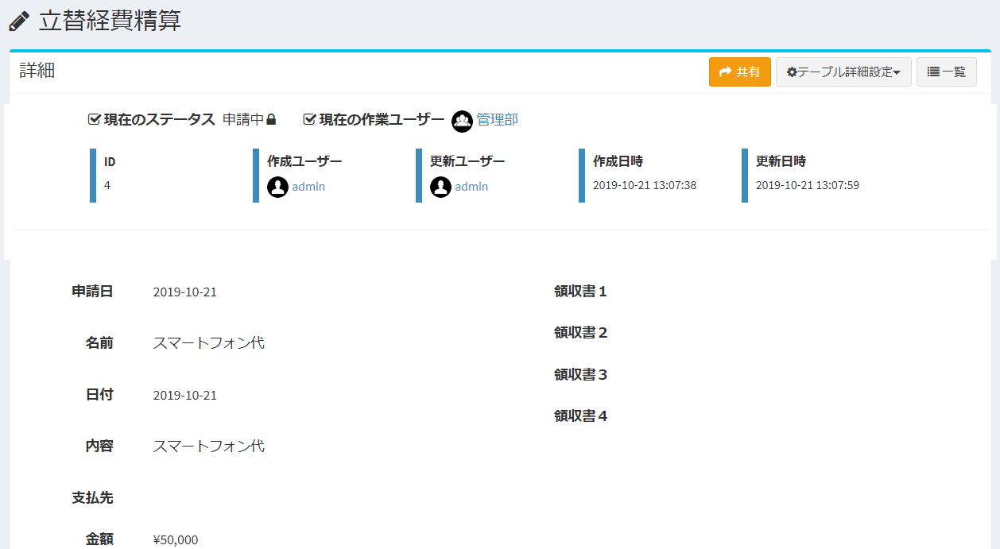

# 执行工作流
这里是用户执行工作流的操作（申请、批准等）的步骤。  
需要管理员事先完成[工作流设置](/zh/workflow_setting)。

## 进行工作流
1. 打开数据后，会显示当前状态，以及下一步进行操作的处理用户和组织。
  

2. 登录用户有权进行下一个操作时，页面右上角会显示操作按钮。  
  

3. 点击按钮后，会显示执行操作的确认对话框。  
  

   - 操作名称  
   显示这次要执行的操作的名称。  

   - 状态  
   显示执行这个操作前后的状态。  

   - 下一处理用户  
   显示执行这个操作之后的处理用户和组织。  

   - 评论  
   请输入执行操作时的评论。  

4. 内容没有问题的话，点击［提交］。操作就会执行。

5. 操作执行后，“当前状态”和“当前处理用户”会改变。  
※根据工作流设置，“当前状态”上可能会显示锁的标记。这时数据被锁定，不能编辑和删除。

  

※从 v7.1.0 起，也可以对数据列表中勾选的多条数据一起执行操作。详情请参阅[数据列表的操作工具](/zh/data_grid_tools)。

## 确认待办任务
需要自己执行操作的数据，可以通过页面右上角的待办任务图标或待办任务列表画面，从所有的表中一起确认。  
详情请查看[待办任务](/zh/workflow_task)。

## 重置工作流的数据

进行中的工作流的数据可以重置。因为某种原因工作流无法继续时，请执行重置。  
重置用命令进行。请在项目的根目录执行下面的命令。

~~~
php artisan exment:workflow-clear (表名) (ID)

# 执行例 重置表名"estimate"、 ID"6"的数据的工作流进度时
php artisan exment:workflow-clear estimate 6

# 执行例 重置表名"syusseki"、 ID"600"的数据的工作流进度时
php artisan exment:workflow-clear syusseki 600
~~~
