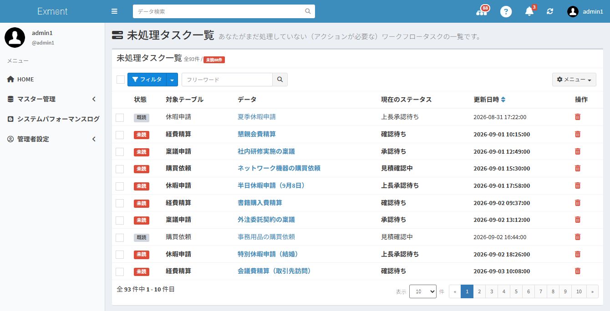
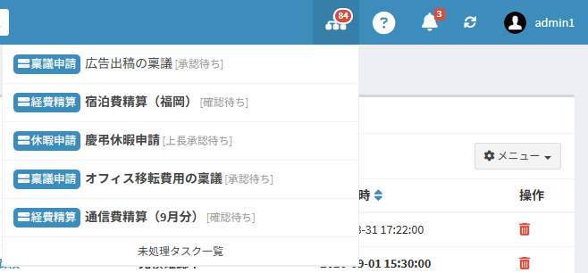
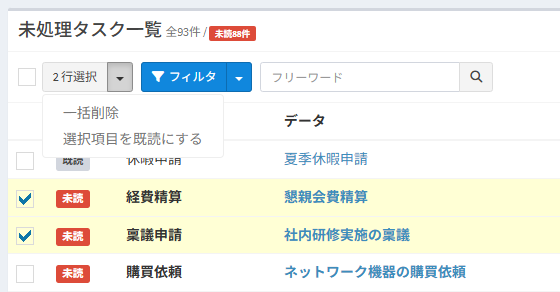
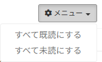
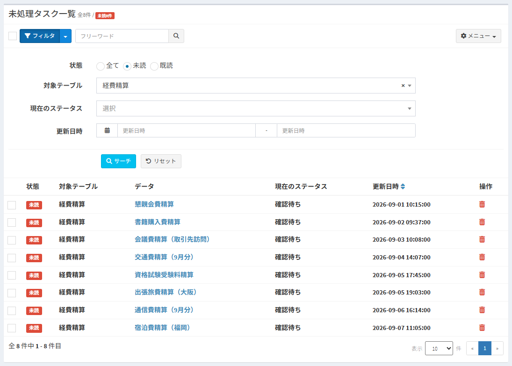
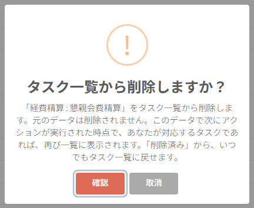
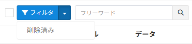
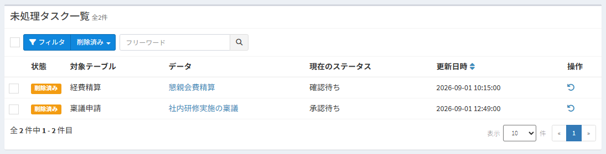

# 待办任务

这个画面把登录用户需要执行操作的工作流数据（任务），从所有的表中集中显示出来。  
通过页面右上角的图标，也可以随时确认待办任务。

## 什么是待办任务

使用工作流时，容易发生下面这样的事。

- 等待批准的数据在哪个表里，不一个一个打开表就不知道
- 没有注意到申请已经送到，处理就停住了

待办任务列表把登录用户 **现在可以执行操作的数据** 跨表显示在 1 个列表中。  
从列表打开后，会转到该数据的详情画面，可以直接执行操作。

### 列表中显示的数据

满足下面所有条件的数据，会作为任务显示。

- 是设为“使用”并且已完成设置的工作流的数据
- 登录用户或登录用户所属的组织是当前状态的处理用户
- 数据的详情画面上显示登录用户可以执行的操作按钮
  - 不满足操作设置的条件的数据不会显示
  - 对“进入下一状态的条件”为 2 人以上的操作，登录用户已经执行过操作时不会显示
  - “特殊操作”不是任务的对象
- 登录用户有查看该数据的权限

※列表中显示的只有登录用户自己的任务。即使是系统管理员，也不会显示其他用户的任务。  
※开始状态的数据（还没有申请的数据等），会作为任务显示给可以执行第一个操作（申请等）的用户。  
※即使过了工作流的“使用结束日期”，已经在进行中的数据在完成之前仍会作为任务显示。

## 打开画面

### 从页面右上角的图标打开

登录后，页面右上角会显示待办任务的图标。  
红色的数字是还没有打开（未读）的任务的条数。

点击图标后，会按更新时间从新到旧显示最多 5 条任务。

- 未读的任务以粗体显示
- 点击任务后，打开该数据的详情画面。任务变为已读
- 点击最下面的“待办任务”，打开列表画面
- 没有任务时显示“没有待办任务。”

※图标上的条数每 5 分钟自动更新一次。从待办任务列表或图标进行操作时（打开任务、标为已读、从列表中移除等）会马上更新。其他的变化（其他用户执行了操作等）会在下次以后的自动更新时反映。更新间隔可以在[设置值](/zh/config)中更改。  
※未读的条数增加时，图标会晃动来提醒。

### 从 URL 打开

访问下面的 URL 也可以显示。

~~~
http(s)://(Exment的URL)/workflow_task
~~~

> ※这个 URL 是不带“/admin”的标准设置（v7.2.1 及以后新安装的站点）下的 URL。如果 `.env` 的 `ADMIN_ROUTE_PREFIX` 有值（用以前的版本安装的站点是“admin”），请在站点 URL 的后面加上这个值（例：`http(s)://(Exment的URL)/admin/workflow_task`）。详情请参阅[更改或删除 URL 中的“admin”](/zh/additional_prefix)。

要添加到左侧的菜单时，请在[菜单](/zh/menu)中把菜单类型设为“自定义 URL”，URI 设为“workflow_task”。

## 画面的看法

### 条数

列表标题的右边显示条数。

| 显示 | 内容 |
| --- | --- |
| 共 ○ 条 | 列表中显示的任务的条数。筛选时是符合条件的条数 |
| 未读 ○ 条 | 还没有打开的任务的条数 |
| 已移除 ○ 条 | 从列表中移除的任务的条数。有 1 条以上时显示。点击后显示[已移除任务的列表](/zh/workflow_task?id=把移除的任务放回列表) |

### 列表的列

| 列 | 内容 |
| --- | --- |
| （复选框） | 选择要一起操作的任务 |
| 状态 | “未读”或“已读”。未读的任务整行以粗体显示 |
| 目标表 | 登记了数据的表 |
| 数据 | 数据的标题。点击后打开数据的详情画面 |
| 当前状态 | 工作流的当前状态。数据不能编辑时显示锁的标记 |
| 更新时间 | 数据的更新时间 |
| 操作 | 用垃圾桶图标把任务从列表中移除。详情请查看[从列表中移除任务](/zh/workflow_task?id=从列表中移除任务) |

- 最初按更新时间从旧到新排列。等待时间越长的任务越靠上。
- 点击“更新时间”右边的图标，可以切换从新到旧、从旧到新。
- 在画面下方可以更改每页显示的条数（10、20、30、50、100 条）。最初是 20 条。

## 处理任务

1. 点击列表中的行。
2. 打开数据的详情画面，任务变为已读。
3. 用页面右上角的操作按钮执行操作。步骤请查看[进行工作流](/zh/workflow_execution)。
4. 执行了操作的数据成为下一处理用户的任务。登录用户不是下一个状态的处理用户时，就不再显示在列表中。

## 未读和已读

- 没有从列表或图标打开过的任务是“未读”。
- 打开任务后变为“已读”。
- 即使是已读的任务，在该数据上执行了下一个操作后，也会再次变为“未读”。不只是状态改变的时候，在需要多人批准的步骤中有人批准的时候也一样。
- 未读和已读按用户分别记录。不影响其他用户的显示，也不影响数据本身。

### 一起标为已读或未读

- **把选择的任务标为已读**：用复选框选择，从出现的［已选择 ○ 项］按钮右边的▼点击“将所选项标为已读”。

- **全部标为已读／全部标为未读**：从右上角的［菜单］选择。在确认对话框中点击［确认］后执行。

※筛选时，只有符合条件的任务是对象。

## 筛选任务

### 关键字

在［筛选］按钮右边的输入栏输入文字，点击搜索图标。  
显示数据的标题（在[标题显示列设置](/zh/table)中设置的列）包含所输入文字的任务。  
也可以用数据的 ID 搜索（例：“#15”或“15”）。

### 筛选

点击［筛选］按钮，会打开条件的输入栏。输入条件，点击［搜索］。

| 项目 | 内容 |
| --- | --- |
| 状态 | 从“全部”“未读”“已读”中选择 |
| 目标表 | 只显示指定的表的任务 |
| 当前状态 | 只显示指定状态的任务。多个工作流中有同名的状态时，合并成 1 个选项显示 |
| 更新时间 | 只显示在指定期间内更新的任务 |

- 点击［重置］，清除筛选的条件。关键字、排列顺序和显示条数保持不变。
- 指定了条件期间，筛选的输入栏保持打开的状态。
- 条件包含在 URL 中。把筛选后的画面加入书签，下次也可以用同样的条件显示。

## 从列表中移除任务

请别人代为负责了、已经用别的方法处理了等，不需要显示在列表中的任务，可以从自己的列表中移除。

- **一条一条移除**：点击行右端的垃圾桶图标，在确认对话框中点击［确认］。
- **一起移除**：用复选框选择，从［已选择 ○ 项］按钮右边的▼点击“批量删除”。

- **数据本身不会被删除。** 只是不再显示在自己的待办任务列表中。也不影响其他用户的列表。
- 该数据下次执行操作时，如果那时登录用户是处理用户，会再次作为“未读”显示在列表中。
- 显示列表之后被执行了操作的数据不会被移除。请重新显示列表，确认最新的状态。没有被移除的条数会用消息显示。
- 为了避免不小心把所有的任务都弄丢，没有“全部移除”的功能。

## 把移除的任务放回列表

从［筛选］按钮右边的▼选择“已移除”，会显示从列表中移除的任务。  
从条数的“已移除 ○ 条”链接也可以显示。

- 点击行右端的放回图标，把该任务放回列表。
- 要一起放回时，用复选框选择，从［已选择 ○ 项］按钮右边的▼点击“将所选项放回任务列表”。
- 放回列表的任务变为“未读”。
- 要回到通常的列表，从▼选择“取消”。

※已经被处理、不再是登录用户的任务的数据，也不会显示在“已移除”中。

## 给同一组织的成员的通知

可执行用户设为“组织”的操作，由组织的 1 个成员执行并且状态改变后，会用[系统内提醒](/zh/notify)通知同一组织的其他成员。  
这样就知道发给组织的任务已经有人处理了，可以省去重复确认同一个任务的工夫。

- 主题：所属组织负责的工作流已被处理
- 正文：（执行的用户）已将“（表名）：（数据的标题）”的状态更改为“（更改后的状态）”。

通知的条件如下。

- 被通知的是属于作为操作处理用户的组织的成员中，可以查看该表数据的用户。执行操作的用户本人不会被通知。
- 处理用户只有“用户”时不会通知。
- 对“进入下一状态的条件”为 2 人以上的操作，只在状态改变时（最后 1 个人执行时）通知。
- 没有使用组织功能时不会通知。
- 这个通知与工作流的通知设置分开发送。不想发送时，请把[设置值](/zh/config)的“EXMENT_SAME_ORG_WORKFLOW_NOTIFY”设为 false。

## 设置值

可以在“.env”文件中更改下面的设置。详情请查看[设置值列表](/zh/config)。

| 设置键 | 默认值 | 内容 |
| --- | --- | --- |
| EXMENT_WORKFLOW_TASK_NAVBAR | true | 为 false 时，不显示页面右上角的待办任务图标 |
| EXMENT_WORKFLOW_TASK_NAVBAR_INTERVAL | 300 | 自动更新图标上的条数的间隔（秒） |
| EXMENT_SAME_ORG_WORKFLOW_NOTIFY | true | 为 false 时，不发送给同一组织的成员的通知 |
